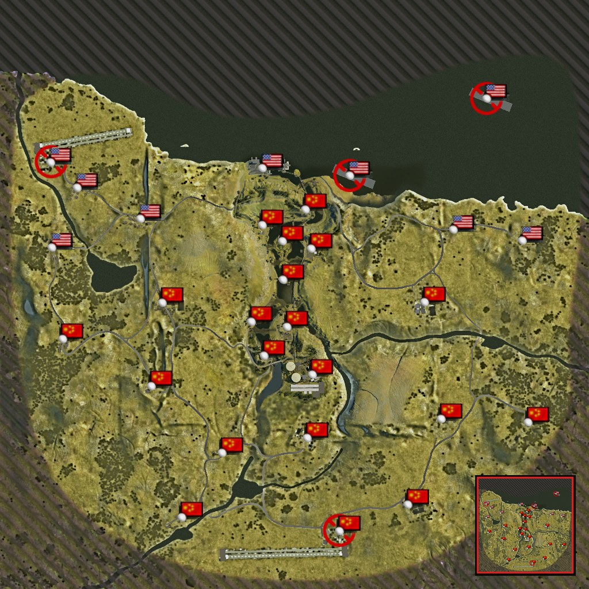

# DREAM_BF256

**Battlefield 2 mod — all maps + Dragon Valley 256 (4×4 km, map size 256), maximum bots**

by **RedSnake** — [dtf.ru/id281079](https://dtf.ru/id281079) · [t.me/arthouseapp](https://t.me/arthouseapp) · [github.com/sidreshot/DREAM_BF256](https://github.com/sidreshot/DREAM_BF256)

**[⬇ Download / Скачать — Releases](https://github.com/sidreshot/DREAM_BF256/releases/latest)**

---

## RU

Мод для Battlefield 2: все карты BF2 для одиночной игры и кооператива с ботами (16/32/64) и новая карта **Dragon Valley 256** — Долина Дракона, расширенная до 4×4 км, размер карты 256: оригинальная долина в центре, две авиабазы, 15 новых контрольных точек, второй авианосец, дороги, реки, леса. Ботов — максимум.

### Требования
- Battlefield 2 с патчем 1.5.

### Установка
1. Скачайте `DREAM_BF256_v1.0.zip` со страницы [Releases](https://github.com/sidreshot/DREAM_BF256/releases/latest).
2. Распакуйте архив в папку `<Battlefield 2>\mods\` — должно получиться `<Battlefield 2>\mods\DREAM_BF256\mod.desc`.
3. Если карты не загружаются (нет `client.zip` у карт), один раз запустите `<Battlefield 2>\mods\DREAM_BF256\DREAM_BF256_copymaps.bat`.

### Как играть
- Ярлык: `BF2.exe +modPath mods/DREAM_BF256` (или выберите **DREAM_BF256** в меню модов).
- Одиночная игра / кооператив: выберите карту **Dragon Valley 256** или любую другую.
- Количество и сложность ботов: `mods\DREAM_BF256\ai\AIDefault.ai` (`aiSettings.setMaxNBots`, `aiSettings.setBotSkill`).

### Сетевая игра
- У всех игроков и на сервере должна стоять одна и та же версия мода.
- Сервер: `+modPath mods/DREAM_BF256`, в `maplist.con`: `mapList.append dragon_valley_256 gpm_cq 256` (кооператив с ботами: `gpm_coop 256`).
- Число игроков на сервере ограничено игрой (64).

---

## EN

A Battlefield 2 mod: every BF2 map for single player and co-op with bots (16/32/64) and a new map, **Dragon Valley 256** — Dragon Valley extended to 4×4 km, map size 256: the original valley in the centre, two air bases, 15 new control points, a second carrier, roads, rivers, forests. Maximum bots.

### Requirements
- Battlefield 2, patch 1.5.

### Install
1. Download `DREAM_BF256_v1.0.zip` from [Releases](https://github.com/sidreshot/DREAM_BF256/releases/latest).
2. Extract it into `<Battlefield 2>\mods\` so that you get `<Battlefield 2>\mods\DREAM_BF256\mod.desc`.
3. If maps do not load (no `client.zip` in a level), run `<Battlefield 2>\mods\DREAM_BF256\DREAM_BF256_copymaps.bat` once.

### How to play
- Shortcut: `BF2.exe +modPath mods/DREAM_BF256` (or pick **DREAM_BF256** in the mod list).
- Single player / co-op: choose **Dragon Valley 256** or any other map.
- Bot count and skill: `mods\DREAM_BF256\ai\AIDefault.ai` (`aiSettings.setMaxNBots`, `aiSettings.setBotSkill`).

### Online
- Every player and the server need the same version of the mod.
- Server: `+modPath mods/DREAM_BF256`, `maplist.con`: `mapList.append dragon_valley_256 gpm_cq 256` (co-op with bots: `gpm_coop 256`).
- Players per server are limited by the game (64).
